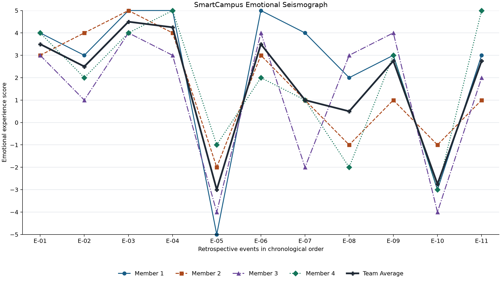

# SIS13-06 Emotional Seismograph and interpretation

**Status:** Ready for review. The submitting user confirmed the four response vectors and permission for coded publication on 23 November 2026. The individual source messages could not be inspected directly because of the ClickUp connector quota. [Pinned ratings CSV](https://github.com/yerassyl-clou/SmartCampus/blob/4499cac600607703499170fcfbd2ce219099348f/docs/SIS13/emotional-seismograph/ratings.csv) · [Collection and provenance](https://github.com/yerassyl-clou/SmartCampus/blob/4499cac600607703499170fcfbd2ce219099348f/docs/SIS13/emotional-seismograph/RATING_COLLECTION.md)



## Interpretation

The highest team average was **+4.50** at E-03, when the SIS 10–11 integration merged. The lowest was **−3.00** at E-05, the recorded delay in ClickUp closure work. The largest drop was **7.25 points** from E-04 to E-05, and the largest rebound was **6.50 points** at E-06, when board closure was completed. The events with a spread of at least four points were E-05 (**4**), E-07 (**6**), E-08 (**5**) and E-11 (**4**). At E-07, scores from **−2 to +4** produced a positive average of **+1.00**, which makes the group mean an incomplete account of the range of experiences. The event register supplies context for when these shifts occurred, and the submitted scores alone leave their causes open. In the next retrospective, ask participants privately about the widest spreads and agree which changes to carry into the next sprint after they have explained their experiences.

[Event evidence register](https://github.com/yerassyl-clou/SmartCampus/blob/d903dfbb3317fff7fdce856b6643fffc33a1071f/docs/SIS13/event-timeline/EVENT_EVIDENCE_REGISTER.md) · [Visual timeline](https://github.com/yerassyl-clou/SmartCampus/blob/61230601ccd026071db44b6a8ca7a600f7065e81/docs/SIS13/event-timeline/EVENT_TIMELINE.md)

## Reproduce the figure

1. Obtain the accepted [SIS13-05 CSV](https://github.com/yerassyl-clou/SmartCampus/pull/36) after Danaya confirms all four independently supplied vectors and coded-publication permissions. Record its commit and the accepted roster revision. Use those sources for the official chart.
2. On the SIS13-06 branch, use the accepted `ratings.csv` path and the pinned roster. If SIS13-05 has not yet been integrated, point `--csv` at its verified checkout. Install Matplotlib and Pillow in a Python environment, then run from the repository root:

```sh
python3 docs/SIS13/emotional-seismograph/render_seismograph.py \
  --roster /path/to/pinned/EVENT_EVIDENCE_REGISTER.md \
  --csv docs/SIS13/emotional-seismograph/ratings.csv \
  --output docs/SIS13/emotional-seismograph/EMOTIONAL_SEISMOGRAPH.png
```

3. Recalculate and review the extrema, adjacent changes and all spreads of at least four points. Inspect the generated PNG for five entries, event order, axis range and readability. Omit `--output` to validate an in-progress CSV.
4. Confirm any proposed individual explanation with its author before adding it. The recorded run used Python 3.12.1, Matplotlib 3.11.2 and Pillow 13.0.0. The output decoded at 2160 × 1215 and reproduced pixel for pixel.

## Demonstration

The [workflow demonstration](demonstration/SIMULATED_ANALYSIS.md) has its own AI-simulated CSV and visibly labeled PNG. To switch to production, use the accepted SIS13-05 input path in the command above. The simulation files stay in the demonstration directory.
