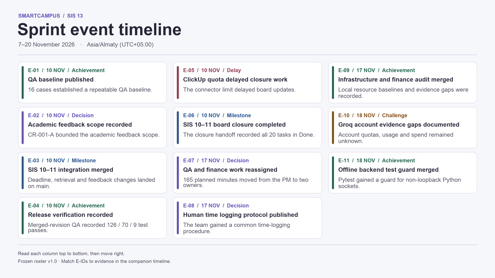

# SmartCampus sprint event timeline

This timeline covers 7–20 November 2026 in Asia/Almaty (UTC+05:00). Read down each column and move right. The E-IDs and neutral labels match the roster supplied to SIS13-05 for independent scoring.

[Frozen SIS13-01 roster v1.0](https://github.com/yerassyl-clou/SmartCampus/blob/d903dfbb3317fff7fdce856b6643fffc33a1071f/docs/SIS13/event-timeline/EVENT_EVIDENCE_REGISTER.md) · [SIS13-02 Visual Event Timeline](https://app.clickup.com/t/z8q7hbx7vw)



| Event | Almaty timestamp | Neutral label | Category | Observed effect | Sources | Grade | Limitation |
| --- | --- | --- | --- | --- | --- | --- | --- |
| E-01 | 2026-11-10T09:36:06.959+05:00 | QA baseline published | Achievement | A pinned, repeatable comparison point was available for the product fixes. | [EV-01-01 ClickUp handoff](https://app.clickup.com/t/z8q7hbuc7k#comment-1100310000174264), [baseline test matrix](https://github.com/yerassyl-clou/SmartCampus/blob/5b4c39627f5f08b367681fa2500fc81c63102762/docs/sis1011/TEST_CASES_AND_RESULTS.md) | corroborated | This is the handoff timestamp. Baseline tests used mocks for provider and browser API responses. |
| E-02 | 2026-11-10T11:08:48.639+05:00 | Academic feedback scope recorded | Decision | The team had a bounded feature scope and linked acceptance cases for implementation. | [EV-01-02 ClickUp decision handoff](https://app.clickup.com/t/z8q7hbuc7w#comment-1100310000174477), [change request](https://github.com/yerassyl-clou/SmartCampus/blob/9cf5f34ccada247bdebf27545e47ff1944fea9d3/docs/sis1011/CHANGE_REQUEST_DOCUMENT.md), [impact reconciliation PR #24](https://github.com/yerassyl-clou/SmartCampus/pull/24) | corroborated | The date is the recorded handoff. The decision is academic and the exact approval time is unavailable. |
| E-03 | 2026-11-10T23:12:00+05:00 | SIS 10–11 integration merged | Milestone | The fixes, feedback and defense package landed on main. | [EV-01-03 integration PR #22](https://github.com/yerassyl-clou/SmartCampus/pull/22), [merge commit](https://github.com/yerassyl-clou/SmartCampus/commit/47a562a4d9eceec7d42f0637de1fd65154b27b19) | direct | The merge time establishes integration. Production deployment and individual work times are outside this evidence. |
| E-04 | 2026-11-10T23:15:53+05:00 | Release verification recorded | Achievement | The release review could cite actual merged-revision logs and a two-row SQLite restart check. | [EV-01-04 verification PR #23](https://github.com/yerassyl-clou/SmartCampus/pull/23), [runtime evidence](https://github.com/yerassyl-clou/SmartCampus/blob/fc62f6c699c05b96d1405a98df229376f5f3c8a3/docs/sis1011/evidence/final-demo/FINAL_E2E_RESULTS.md) | corroborated | Timestamp is evidence publication on main. Results are historical local runs under their recorded conditions. |
| E-05 | 2026-11-10T23:22:17.610+05:00 | ClickUp quota delayed closure work | Delay | The board lagged behind product integration while task verification and status updates were pending. | [EV-01-05 delayed ClickUp update](https://app.clickup.com/t/z8q7hbuc8r#comment-1100310000175886), [closure record in PR #25](https://github.com/yerassyl-clou/SmartCampus/pull/25) | corroborated | This timestamps the report of the delay. Exact quota onset and impact on the submission deadline are unverified. |
| E-06 | 2026-11-10T23:24:42.101+05:00 | SIS 10–11 board closure completed | Milestone | The final technical acceptance and board status were traceable to the reviewer’s task-level records. | [EV-01-06 SIS1011-20 task](https://app.clickup.com/t/z8q7hbuc8r), [acceptance comment](https://app.clickup.com/t/z8q7hbuc8r#comment-1100310000175906), [published closure register](https://github.com/yerassyl-clou/SmartCampus/blob/3e1807417c497330b24ea6b22c6eec9b3ce16589/docs/sis1011/CLICKUP_ACCEPTANCE_HANDOFF.md) | corroborated | The timestamp is live ClickUp date_closed for SIS1011-20. The PR #25 merge documents the same closure and is excluded as a separate event. |
| E-07 | 2026-11-17T11:09:16.215+05:00–11:09:18.675+05:00 | QA and finance work reassigned | Decision | 165 planned minutes moved from the PM to those two owners. | [EV-01-07 QA reassignment](https://app.clickup.com/t/z8q7hbw37w#comment-1100310000188262), [finance reassignment](https://app.clickup.com/t/z8q7hbw37x#comment-1100310000188263), [board evidence in PR #26](https://github.com/yerassyl-clou/SmartCampus/blob/736e30c020ac38ff3910bebc3fa9cedfd73a4dcc/docs/sis12/BOARD_BEFORE_AFTER_EVIDENCE.md) | corroborated | The interval brackets the two confirmations. Estimates are planned minutes. The separate SIS12-01 transfer lacks equivalent before-state evidence and is excluded from this figure. |
| E-08 | 2026-11-17T11:09:20.489+05:00 | Human time logging protocol published | Decision | Owners received a common start/end and variance procedure against a known tracking gap. | [EV-01-08 ClickUp policy publication](https://app.clickup.com/t/z8q7hbw386#comment-1100310000188264), [policy in PR #27](https://github.com/yerassyl-clou/SmartCampus/blob/926ef53230a5a35c415b7219d811480747e2ebba/docs/sis12/TIME_TRACKING_PROTOCOL.md), [review checkpoint](https://app.clickup.com/t/z8q7hbw386#comment-1100310000189463) | corroborated | Missing positive entries establish a tracking gap. Pilot adoption and actual effort were unverified in the historical evidence reviewed. |
| E-09 | 2026-11-17T22:37:53+05:00 | Infrastructure and finance audit merged | Achievement | The team gained a local resource baseline and an explicit list of account limits to confirm. | [EV-01-09 resource PR #28](https://github.com/yerassyl-clou/SmartCampus/pull/28), [infrastructure audit](https://github.com/yerassyl-clou/SmartCampus/blob/8ad73158a9c6961101ec6469835c5aab17cd8642/docs/sis12/INFRA_RESOURCE_LIMITS.md) | corroborated | Local fixture and workstation figures have limited scope. Account billing, production capacity and hosted uptime were unverified. |
| E-10 | 2026-11-18T00:03:08+05:00 | Groq account evidence gaps documented | Challenge | The resource review had to carry those values as unknown and request owner verification. | [EV-01-10 provider PR #29](https://github.com/yerassyl-clou/SmartCampus/pull/29), [Groq audit](https://github.com/yerassyl-clou/SmartCampus/blob/43872ef92c1cf1df0be723f4372940b385b16368/docs/sis12/GROQ_API_RESOURCE_AUDIT.md) | corroborated | Merge crossed midnight in Almaty. The audit recorded example configuration and illustrative rates. |
| E-11 | 2026-11-18T00:03:12+05:00 | Offline backend test guard merged | Achievement | Default backend pytest gained an executable safeguard against accidental external Python socket connections. | [EV-01-11 offline guard PR #30](https://github.com/yerassyl-clou/SmartCampus/pull/30), [guard and test evidence](https://github.com/yerassyl-clou/SmartCampus/blob/6645b5ef95e2cb4d00aa4bb6756705ac84475654/docs/sis12/PROVIDER_TEST_OPTIMIZATION.md) | corroborated | The merge followed the 17 November local tests. The guard permits loopback and Unix sockets. Subprocess network activity and provider-wide savings were outside the measurement. |

The register retains original timestamp zones and gives the meaning of each evidence grade. The Groq audit and guard PRs merged after local midnight on 18 November. The 23–24 November improvement cycle is outside this figure.

## Reproduce the figure and table

Use Python 3.11 or newer, Pillow 12.2.0 and Arial regular and bold fonts. Run from this branch with the frozen register commit available locally.

```sh
git show d903dfbb3317fff7fdce856b6643fffc33a1071f:docs/SIS13/event-timeline/EVENT_EVIDENCE_REGISTER.md > /tmp/sis13-roster-v1.md
python docs/SIS13/event-timeline/render_timeline.py /tmp/sis13-roster-v1.md \
  --font "/System/Library/Fonts/Supplemental/Arial.ttf" \
  --bold-font "/System/Library/Fonts/Supplemental/Arial Bold.ttf"
```

The renderer checks event order and text bounds. The image is 3,200 × 1,800 pixels at 300 DPI.
