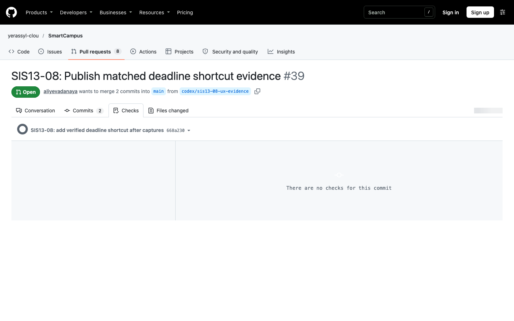
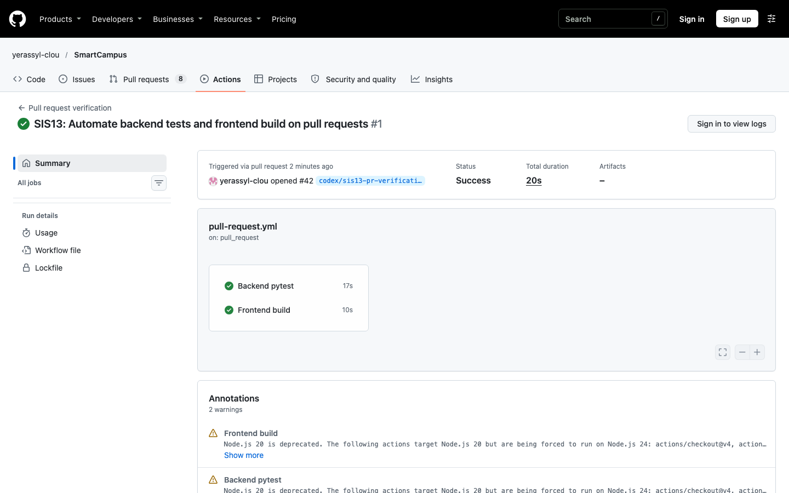

# SmartCampus sprint retrospective
IT Project Management · SIS 13 · English retrospective report · 24 November 2026

## Executive summary
The retrospective covers 7-20 November 2026 in Asia/Almaty. Eleven documented events show how the team moved from a measured QA baseline to the SIS 10-11 release and then addressed resource visibility and offline testing in SIS 12.

The release combined deadline grouping, course-aware retrieval and answer feedback. The team recorded tests on the merged revision and closed 20 associated ClickUp tasks. Later work redistributed two documented responsibilities and exposed gaps in time tracking and provider account evidence.

## Evidence at this checkpoint
- The frozen event register and the independently approved timeline are integrated in main.
- The deadline shortcut failed in both tested layouts while six deadline records were available. The direct dashboard candidate passed both matched local journeys, with 0/2 failures. Independent reruns passed 72 browser and 127 backend tests. The PM retrospectively approved A-01 on 24 November.
- Five evidence-ranked insights and three approved actions support the follow-up. Independent ratings and consent still require verification. The UX and hosted CI improvements have measured results. A one-task board pilot adds a third measured result.

This report is for team review. The 23-24 November follow-up cycle is reported separately from the historical observation window.

See the [SmartCampus Task Board](https://app.clickup.com/1100310000007240/v/l/z8q7hb2y28-378) and [delivery playbook](https://github.com/yerassyl-clou/SmartCampus/blob/main/docs/SIS13/AGENT_PLAYBOOK.md).

---

# Reporting period and method
## Window and product boundary
The observation window is 7-20 November 2026 inclusive in Asia/Almaty (UTC+05:00). The 23-24 November follow-up contains candidate measurements and later improvements. Earlier SIS 8-9 QA is background. SmartCampus uses fictional course data in a React, FastAPI and SQLite prototype.

## Event evidence
The roster uses stable E-IDs. GitHub merge metadata establishes when changes reached main. ClickUp comments and closure records establish documented decisions and board events. UTC source timestamps are preserved and converted to UTC+05:00. Several sources document the same event and share its E-ID.

Direct evidence supports the fact it records. Corroborated evidence combines agreeing records. An item remains uncertain where its source cannot establish the claimed outcome. The verified historical delay concerns board updates. The records do not establish a missed assignment deadline.

## Current limits
The integration review verified the original ClickUp comments and closure field for E-01, E-02 and E-05 through E-08. GitHub sources and timezone conversions were also checked. A PR merge time establishes publication or integration, while a test log carries its own execution date.

See the [frozen register with source grades](https://github.com/yerassyl-clou/SmartCampus/blob/d903dfbb3317fff7fdce856b6643fffc33a1071f/docs/SIS13/event-timeline/EVENT_EVIDENCE_REGISTER.md) and [SIS 10-11 acceptance evidence](https://github.com/yerassyl-clou/SmartCampus/blob/9dff9c289289eda7bb2402fb2ef2075f1b7d6571/docs/sis1011/FINAL_ACCEPTANCE_REPORT.md).

---

# Event timeline
The figure follows the same order as the independent rating template. Read down each column, then move right.

- 10 Nov · E-01 QA baseline published. The team had 16 repeatable cases for comparison.
- 10 Nov · E-02 Academic feedback scope recorded. CR-001-A bounded the simulated requirement change.
- 10 Nov · E-03 SIS 10-11 integration merged. Dashboard, retrieval and feedback reached main.
- 10 Nov · E-04 Release verification recorded. Merged-revision rerun logs supported acceptance.
- 10 Nov · E-05 ClickUp quota delayed closure work. Board updates followed product integration.
- 10 Nov · E-06 SIS 10-11 board closure completed. The closure handoff recorded 20 tasks in Done.
- 17 Nov · E-07 QA and finance work reassigned. Two documented moves shifted 165 planned minutes.
- 17 Nov · E-08 Human time logging protocol published. Owners received a common procedure.
- 17 Nov · E-09 Infrastructure and finance audit merged. Local baselines and evidence gaps became visible.
- 18 Nov · E-10 Groq account evidence gaps documented. Account quotas, usage and spend stayed unknown.
- 18 Nov · E-11 Offline backend test guard merged. Default pytest gained an external Python socket guard.

See the [timeline and evidence links](https://github.com/yerassyl-clou/SmartCampus/pull/33) and [Danaya’s review of the current render](https://github.com/yerassyl-clou/SmartCampus/pull/33#pullrequestreview-6016703941).

---

# Emotional Seismograph
The PM authorized use of the existing 44 ratings on 24 November 2026 in the SIS13-05/06 Final Data Confirmation handoff. The four coded series and the mean use the frozen E-01–E-11 order.

The values exactly match the earlier AI-assisted demonstration. Independent original responses and individual permission for coded publication remain unverified. The figure summarizes the authorized dataset. The academic criterion for independently collected ratings remains open. Source messages and identity mappings stay private.

See the [collection record](https://github.com/yerassyl-clou/SmartCampus/pull/36) and the [analysis handoff](https://app.clickup.com/t/z8q7hbx7vz#comment-1100310000222509).

---

# Retrospective interpretation
## Findings supported by project records
The team established an executable QA baseline before the release. E-04 documents 126 backend, 70 standard browser and nine live browser checks passing on the merged release revision in separate logged local runs. E-05 documents a connector quota issue during board closure activity. E-06 records closure of the final QA task after acceptance and the handoff reports 20 tasks Done.

E-07 documents two reallocations totaling 165 planned minutes. E-08 records a time logging protocol and zero positive tracked-time entries in the historical 20-task sample. These records establish assignment and process facts. Actual effort and participant reactions remain unverified.

## Interpretation of the authorized dataset
The mean peaked at +4.50 on E-03 and reached −3.00 on E-05. The largest adjacent drop was 7.25 points from E-04 to E-05, followed by a 6.50-point rebound from E-05 to E-06. Spreads of four points or more occurred at E-05 (4), E-07 (6), E-08 (5) and E-11 (4). These are properties of the authorized dataset. Participant reactions and the causes of the score differences remain unverified.

See the [event register](https://github.com/yerassyl-clou/SmartCampus/pull/32), [closure evidence](https://github.com/yerassyl-clou/SmartCampus/pull/25) and [allocation evidence](https://github.com/yerassyl-clou/SmartCampus/pull/26).

---

# Insight backlog and root causes
The Yerassyl/Codex contribution ranks insights by observed impact, evidence quality and feasibility. The PM accepted this contribution as the action plan’s content input. Gleb retains ownership of the upstream task and process-audit reconciliation.

| Ranked insight | Event and observed impact | Root cause and response |
| --- | --- | --- |
| I-01 · Deadline discovery | E-01, E-03. Deferred SC-ISS-003 failed on 2/2 layouts in the later replay. | The welcome prompt used unsupported chat phrasing for navigation. A-01 uses the existing panel link. |
| I-02 · PR verification | E-04, E-09, E-11. Repeatable local testing with zero hosted workflow definitions. | Local commands and the existing test guard lacked a PR trigger. A-02 adds hosted jobs. |
| I-03 · Board traceability | E-05, E-06. Quota delayed historical closure. The pilot baseline had 0/1 complete records. | Pilot comments covered progress and a deferred decision. A-03 posts revision-pinned acceptance. |
| I-04 · Actual effort | E-07, E-08. Two moves shifted 165 planned minutes. Zero of 20 historical tasks had positive tracked time. | Estimates and assignment history did not establish actual effort. Check adoption of the SIS12 protocol. |
| I-05 · Provider visibility | E-09, E-10. The local fixture measured 36,864 bytes. Account usage and spend stayed unknown. | Account evidence must come from the provider account. Request a dated owner snapshot. |

The Five Whys chains distinguish observed mechanisms from hypotheses about initial decisions, logging adoption and missing account data. The documented quota delay and later closure warrant discussion about the handoff. The ranking uses documented project evidence. The PM-authorized rating series is summarized separately.

See the [ranked backlog, Five Whys and action decision](https://github.com/yerassyl-clou/SmartCampus/pull/34).

---

# Improvement action plan
The PM approved three SMART actions on 24 November 2026 under centralized technical review. All dates and times below use Asia/Almaty.

| Action and trace | Owner and deadline | Measurement procedure | Baseline / target / actual |
| --- | --- | --- | --- |
| A-01 / I-01 / E-01, E-03. Direct welcome link to deadlines. | Danaya Aliyeva. 24 Nov, 12:00. | One matched local Chromium keyboard journey each on desktop and mobile. | Failed journeys 2/2 / 0/2 / 0/2 |
| A-02 / I-02 / E-04, E-09, E-11. Hosted PR regression checks. | Yerassyl Babayev, technical contribution. 24 Nov, 18:00. | Count backend pytest and frontend build jobs on a PR to main. Target requires both to pass. | Automated jobs 0/2 / 2/2 / 2/2 passed |
| A-03 / I-03 / E-05, E-06. Revision-pinned board acceptance. | Yerassyl Babayev, pilot. 24 Nov, 18:00. | Score the same SIS13-08 task for one comment with reviewer, PR, revision and dated decision. | Complete records 0/1 / 1/1 / 1/1 |

A-01 and A-02 were the independent delivery candidates. The PM approved A-01 retrospectively after implementation and measurement. SIS12's time-logging procedure and offline guard serve as historical inputs. Hosted execution and the new board acceptance record were produced in SIS13.

See the [action plan](https://github.com/yerassyl-clou/SmartCampus/pull/34), [hosted run](https://github.com/yerassyl-clou/SmartCampus/actions/runs/45393821788) and [ClickUp acceptance record](https://app.clickup.com/t/z8q7hbx7w3#comment-1100310000222417).

---

# A-01 · Deadline shortcut
Before (EV-07-01). The desktop welcome question reached an ungrounded fallback with zero sources while six records existed in the deadline panel.

After (EV-07-02). The native link opened and focused Course deadlines, exposed all six records and sent zero chat POSTs during navigation.

Desktop and mobile moved from 2/2 failures to 0/2 on the local fixture. Baseline 6645b5e, tested app 748f695. See the [mobile and desktop originals](https://github.com/yerassyl-clou/SmartCampus/pull/39) and [replay and regression results](https://github.com/yerassyl-clou/SmartCampus/pull/38).

---

# A-02 · Hosted PR checks
Before (EV-15-01). PR #39 at 668a230 showed no checks. Main at 4aeb0a1 held zero workflow definitions.

After (EV-15-02). PR #42 at eabdbf3 triggered both jobs. Backend pytest and frontend build passed.

Automated coverage rose from 0/2 to 2/2 for the sampled PRs. Both after jobs passed and PR #42 merged into main at 25df09f. The sample covers one hosted run and leaves deployment and provider usage outside the measurement. See [before checks](https://github.com/yerassyl-clou/SmartCampus/pull/39/checks) and the [hosted run](https://github.com/yerassyl-clou/SmartCampus/actions/runs/45393821788).

---

# Measured results and limitations
| Metric | Actual | Limit |
| --- | --- | --- |
| Deadline discovery | 2/2 failed before and 0/2 after. Six records, keyboard focus and zero chat POSTs after. | Same fictional local dataset and two Chromium layouts. |
| UX regression suites | 72 browser and 127 backend tests passed on the evidence revision. | Local runtime and the recorded fixtures. |
| Hosted PR checks | 0/2 before and 2/2 executed successfully after. | One hosted run. Backend pytest uses the existing SIS12 socket guard. |
| Board pilot | 0/1 before and 1/1 after. | One board task. Review turnaround and team adoption remain unmeasured. |

## A-03 board evidence
The prior SIS13-08 comment recorded a baseline capture and pending scope. The new authenticated ClickUp record names the PM reviewer, links PR #39, pins 668a230 and states the dated acceptance decision. Read the [before comment](https://app.clickup.com/t/z8q7hbx7w3#comment-1100310000219176) and [after comment](https://app.clickup.com/t/z8q7hbx7w3#comment-1100310000222417) on the [SmartCampus Task Board](https://app.clickup.com/1100310000007240/v/l/z8q7hb2y28-378).

## Rubric and next checkpoint
The report covers the timeline, ranked insights, root causes, SMART actions, two measured improvements and the board pilot. The PM-authorized figure and interpretation are included with the independent-collection and consent limits.

Before submission, verify the defense uses the same figures and identifiers, team members confirm contributions, and the audience can access the linked materials. Use the same rating-status disclosure in the deck.

---

# Contributions and references
The table separates evidenced work from assignments and outstanding confirmations. The named authors retain credit for their work.

| Member | Verified or published contribution | Outstanding handoff |
| --- | --- | --- |
| Yerassyl Babayev | Frozen register, timeline and PM review. Codex-assisted backlog, plan, CI workflow, board pilot, audit and report. | Report integration |
| Danaya Aliyeva | Timeline review, Rating collection materials, chart renderer, UX implementation and matched captures | Defense coordination and private rating receipts |
| Gleb Yurtayev | SIS12 infrastructure and finance audit used as evidence. Assigned SIS13 process/insight lead. | SIS13 contribution confirmation pending |
| Ratislav Ovchinnikov | SIS12 provider audit used as evidence. Assigned SIS13 technical lead. | SIS13 contribution confirmation pending |

## Primary references
- [SmartCampus Task Board](https://app.clickup.com/1100310000007240/v/l/z8q7hb2y28-378) and [SIS13 task dependency index](https://github.com/yerassyl-clou/SmartCampus/blob/9dff9c289289eda7bb2402fb2ef2075f1b7d6571/docs/SIS13/TASK_DEPENDENCIES.md)
- [Frozen event register](https://github.com/yerassyl-clou/SmartCampus/pull/32) and [approved visual timeline](https://github.com/yerassyl-clou/SmartCampus/pull/33)
- [Action plan](https://github.com/yerassyl-clou/SmartCampus/pull/34) and [rubric audit](https://github.com/yerassyl-clou/SmartCampus/pull/35)
- [Rating collection record](https://github.com/yerassyl-clou/SmartCampus/pull/36) and [Seismograph preparation](https://github.com/yerassyl-clou/SmartCampus/pull/37)
- [UX candidate tests](https://github.com/yerassyl-clou/SmartCampus/pull/38) and [original UX captures](https://github.com/yerassyl-clou/SmartCampus/pull/39)
- [Hosted workflow implementation](https://github.com/yerassyl-clou/SmartCampus/pull/42) and [defense handoff](https://github.com/yerassyl-clou/SmartCampus/pull/41#issuecomment-7131524262)
- Course handout: SIS 13. Sprint Retrospective & Continuous Improvement Challenge, IT Project Management.
- Historical contributions: [Gleb’s infrastructure and finance audit](https://github.com/yerassyl-clou/SmartCampus/pull/28) and [Ratislav’s provider audit](https://github.com/yerassyl-clou/SmartCampus/pull/29).
