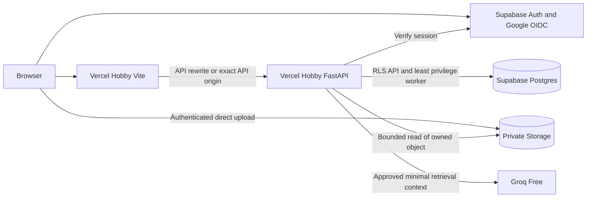

# Master Delivery Contract

Approved V2 scope · publication adjustments are recorded in the Task Index. All scheduling uses Asia/Almaty (UTC+05:00).

## Objective

A student can try a synthetic guest workspace, sign in through open self-service, make a course, upload an authorized PDF/DOCX, ask Groq a question and follow its source, manage deadlines, and return to the same data and chats. Use existing React/Vite + FastAPI and extend current grounding, answer UX and historical acceptance evidence. No KBTU-only model or university integration is required. Long-term persistence is supported. Operating commitments cover the exam window only.

**Two release profiles.** `workspace` opens real Google registration, personal data and default Groq only after legal, OAuth, isolation, technical and quota checks. `public-demo` opens synthetic courses, a bounded real demo chat when allowed or clearly labeled examples, example syllabus and deadline dashboard. In that profile real login and uploads are disabled at Auth/API/Storage, and only approved isolated QA may exercise them with synthetic data. Published demo is a genuine functional fallback with no real workspace-pilot metrics. Public UI explicitly states availability as observed.

**Schedule.** Development 25–29 Nov, target deployment Monday 30 Nov 13:00. Cutoff for observations 2 Dec 10:00, evidence freeze 12:45, package RfR 16:30 and LMS submission target 18:00. Course criterion and exam upload have precedence. 45h elapsed in the standard schedule, with conditional early-release and late-release branches in §8. Sprint target 10 exploratory, 20 target, 30 stretch actual verified student users. Instructor condition is unknown. No automatic grade promised.

Product and experience

**Product name.** SmartCampus Student Workspace. Initial reach KBTU students, model accepts an externally authenticated adult from any eligible campus. Courses belong to a user, with user-entered labels instead of campus IDs/SSO restrictions. Target job: store class material once, ask evidence-backed questions, and see the next actionable deadlines without searching several systems. Market demand, time saved and student satisfaction are hypotheses. No commercial operation is planned. User is student; buyer/sponsor is a distinct future hypothesis.

| Story | MoSCoW / owner | Observable acceptance |
| ---| ---| --- |
| V2-US01 Explore as guest | Must · D/R | Guest opens labeled synthetic course, syllabus, deadlines and demo chat, with registration CTA if workspace enabled. Demo cannot upload/write/read real state. Live synthetic examples use a bounded budget; labeled interactive replay remains usable after budget exhaustion. T01. |
| V2-US02 Join and return | Must · D/R/Y | Any eligible external Google user self-registers, verifies provider identity, reopens a session on reload/new tab and can log out. No manually approved account. Unverified, stale or invalid credentials are denied. T02/T03. |
| V2-US03 Organize courses | Must · D/R/G | User creates, opens, renames and deletes owned courses up to 10; data persists between sessions. Second account cannot see or alter them. T03/T04. |
| V2-US04 Bring materials | Must · D/G/R | PDF/DOCX up to scheduled resource limits, status pending/processing/ready/error, retry, matching duplicates and safe scanned/corrupt response. Owned ready docs persist and citation opens original or stable excerpt. Delete material removes its files/chunks/history evidence access. T05–T08. |
| V2-US05 Ask AI with sources | Must · R/G/D | Single-course Groq chat with bounded context, exact citations and validated claims; reopen history after logout/login; create a separate thread. Render correct language EN/RU/KK. Insufficient, provider error and rate limit visible; no invented source. T09–T11. |
| V2-US06 Plan deadlines | Must · R/G/D | Create/edit/delete/complete dates, show due today/upcoming/overdue/course. Extraction surfaces only exact explicit dates as candidates; relative Week 8 remains undated. Provenance source and confirm/reject before a deadline becomes active. T12. |
| V2-US07 Control data | Must · R/G/D | View privacy notice, sign out, request and complete account deletion with isolation and revoked access. Self-service without operator manually approving registration. T13. |
| V2-US08 Navigate in comfort | Must · D | Original logo and favicon, responsive keyboard paths, light/dark and EN/RU/KK translation switch. Complete loading/empty/error/success/denied states; preference persists locally. T14. |
| V2-US09 Observe real use | Must · Y/G/R/D | Protected aggregates with filters/dates/definitions, account and meaningful use separated from test and guest, clean CSV/cache and quotas. Instructor sees only sanitized counts, permissioned proof. T15/T16. |
| V2-US10 Find across courses | Should · G/R | Stage optional all-owned collection query using same ACL/limits, no cross-account results. Single-course remains core. |
| V2-US11 General answers and feedback | Could · R/D | No general ungrounded mode in base. Structured feedback may use existing rating patterns if inexpensive; optional approved channel otherwise. A later mode must be explicitly labeled general and show no citation. |
| V2-US12 Integrations and follow-up | Won't this cycle | Microsoft Teams/Graph sync, university partnership, full calendar, notifications, OCR, paid API, complex admin, native mobile, PWA and post-exam production support deferred. Teams remains a roadmap option requiring separate permission. |

## Team ownership

| Owner | Role and execution identity |
| ---| --- |
| Babayev Yerassyl | Coordinator and formal reviewer for all 21 tasks. Owns status, release, authorization and final binaries. GitHub yerassyl-clou. |
| Danaya Aliyeva | Design, localization, frontend and pilot UX. GitHub aliyevadanaya. |
| Gleb | Schema, Storage/data lifecycle, business case, forecasts and actuals. GitHub Gleb-Y. |
| Ratislav | API, CI, LLM orchestration, qualification and offline demo. GitHub ratislavka. |

## Delivery, review and communications

The list workflow is To Do → In Progress → Review → Done. Each owner submits the review packet by the native due date with a readable PR or artifact, exact revision, summary, actual checks, acceptance checklist, limitations, evidence and handoff state. Yerassyl Babayev formally reviews in the slot from the index. Use the same branch for remediation. On acceptance, record the accepted revision or artifact and proof. Yerassyl documents his own verification and captures independent peer evidence where applicable. The accepted merge or equivalent artifact and actual checks are required for Done.

Publish handoffs through versioned repo files and PRs. Target ClickUp notices to an identified actor when delivery, delay or an acceptance gate requires action. Use the existing branch and PR if present. Record pending operations when throttled. Each human launches or resumes their own agent at the checkpoints in the schedule.

Every producer supplies a status with exact date, path, contract version, PR/SHA or checksum, expected check, and fallback. A consumer reconciles the exact artifact and scope, runs the stated acceptance check and records any gap. Explicit fixture and public-demo modes preserve work when real authorization, data, integration or capacity is unavailable.

MASTER AGENT PLAYBOOK & DELIVERY CONTRACT

This is the English delivery contract for authorized execution. FINAL-01 mirrors it under docs/final-exam with TASK\_INDEX, HANDOFF\_MATRIX, SOURCE\_REGISTER, ARTIFACT\_SCHEMAS, RUBRIC\_MATRIX and STATUS\_LEDGER. Docs must also expose approved product/API/data/quota/schedule definitions, so owners need no chat or V1. Ask Yerassyl for permissioned originals or extracts and a source hash; no personal files or private workbooks in public repo, no unauthorized copies of academic brief.

### Running work independently

1. Confirm individual GitHub/ClickUp identity and local author. Y yerassyl-clou, D aliyevadanaya, G Gleb-Y, R ratislavka. Verify the actual execution identity separately from the publisher. Babayev Yerassyl (308552668) remains owner and reviewer. Yerassyl2 (252180871) and Yerassyl3 (authenticated ClickUp display name Yerassyl, 314551066) are separate publication connections. Use actual assigned identity only.
2. Owner reads own task, exact baselines and N/I prerequisites. Pick next runnable owned task at day checkpoint, not someone else's assignment. Fixture work can proceed on approved preliminary version. Never consume real owner data from another actor. Plan checkpoint time plus issue and resume.
3. Recheck accepted main SHA, create or resume one existing branch/worktree according to task ID. No destructive checkout/reset or overwrites of prior changes. Do not duplicate PRs. Rebase unpublished own commits where safe; merge-forward and replay scoped checks after published drift. Shared path changes need single writer, versioned CR and acceptance before merging.
4. Move status to in progress once, with start time and source ID when relevant. Record estimations separately from human actual. Record one useful update per material state: first runnable start, actionable blocker/handoff, RfR, and formal decision. Delivery packet and significant accepted SHA may be one comment each. Routine polling, repeated status notices and commit messages mirrored to ClickUp are unnecessary.
5. Put actual work and proof in owner packet and send planned handoffs before RfR. GitHub/Markdown durable first. ClickUp targets only blocked/needs owner coordination/accepted. If rate-limited, record pending update in authorized ledger and retry at reported reset, never switch accounts to continue quota. After session end humans relaunch at checkpoint with owner prompt and current status, a comment alone does not wake another agent.
6. PR body includes stable ID and actual task URL if resolved, purpose, baseline, head, affected owned files, scope, tests/run links/cases, limitations and inputs. Accepted gate requires precise SHA and artifact status. Show independently generated signed consent or attendee/feedback evidence only when a human actually supplies it. Do not assume real account/doc use or effect from test. No live deployment or provider calls within default CI.
7. Self-check before review at exact due; move to review and include owner/next actions plus critical phase. Y reviews in fixed slot. For peer PR Y records actual reviewed SHA and approved/needs changes; for own tasks Y records self-verification and peer proof if available, not independent PR approval. If branch rules require another authorized peer review, use actual approval only. Fix with same PR. Integration uses accepted SHA and scoped combined test. Done only with real acceptance, or accepted explicit fallback deliverable where scoped, never as launched claim for hold.
8. If real/foreign data/legal provider gates not authorized, disable feature immediately. Use controlled synthetic test, public demo only if permitted. Do not alter SIS13 tasks during this delivery. Pause app/data/LLM outside approved semester scope. Y owns releases, account controls and shutdown.

### Schemas and file map

| Path under docs/final-exam | Writer and required fields |
| ---| --- |
| tasks/FINAL-XX.md | Each writer. task ID, owner, scope/rubric/stories, actual start/delivery, baseline/head/merge separately, changed files and rationale, exact commands/observed results, evidence links, assumptions/open risks, mode/date classifications, actual vs planned minutes, English slide synopsis and recommended visuals. |
| handoffs/FINAL-XX.md | Each producer. handoff ID, from/to, state preliminary/ready/accepted/blocked, contract version, path/PR/checksum, actual occurred\_at ISO, deadline, next operation, limitations, assumed prerequisite and recovery. Verify accepted head from ledger. |
| activity/FINAL-XX.csv | Each writer. local\_date, stable\_id, owner, started\_at/end, planned\_minutes, hands\_on\_minutes\_or\_null, effort\_type, from\_status, to\_status, blocker, source. Count actual owner work separately from AI/wait/peer review. |
| contributions/FINAL-XX.json | Each person per owned task. ID, role, work items/proof, estimated and actual or unknown minutes, method, date, AI tools + purpose, English slide/speaker notes, approved visuals, independently confirmed\_by/at. 21 collects one owner file plus peer addendum. May not infer contribution shares from raw commits. |
| evidence/FINAL-XX/ | Actual photos/screens/logs with ID EV-FINAL-XX-NN, date, dataset and environment, case/expected/observed, exact revision, device/viewport, privacy/classification, rights/view access limitations. Do not push private real records. Use controlled pointer. |
| contracts/ | R04 API, G03/07/09 schema/ingest/data ops, frozen version. Request field changes only with CR. Fixtures and examples published before consumers need. |
| design/, quality/, product/, monitoring/, finance/, requirements/, risk/, pilot/, presentation/, submission/ | See exact writers in descriptions. Y single status/release/final-binary writer; D single frontend/UX writer; G single schema/forecast/metrics-query/actuals writer; R single API/CI/QA/debt and recording owner. Cross-owner edits require agreed small handoff. |

All owners provide actual activity/cost artifact or unknown and independent contribution receipts by Dec2 10:30 before 19 closing; append accepted later work in 21 addendum. Interim spending report by Nov29 12:00 to G15. Each producer writes the English content and evidence before RfR, including example “what changed, why, proof and boundaries”. Aggregator collects accepted artifacts, never invents their inputs. Instructor access is tested from permitted viewer. No secrets anywhere in Git, ClickUp, screenshots or logs. Private file samples synthetic/permissioned controlled.

**CI and risk depth.** One versioned GitHub Actions workflow, normal public standard runner and contents read. Backend Python 3.12/pinned requirements and network guard, frontend Node 22 npm lock + Playwright. Run root `python -m pytest backend/tests -q`; under frontend `npm ci`, `npm run build`, `npx playwright install --with-deps chromium`, `npm test`; disposable local Supabase integration and synthetic fixtures separate. Optional external smoke manually authorized, capped ops partition, no live keys in fork workflows. Required evidence explicit environment, filters, check/run URL and result at actual head. Fixture tests improve confidence and do not authorize external processing. Record failed environment checks and no substitute CI result. Data/role isolation, direct Storage and FK, app reboot/reconnect, timeout/dedupe and immutable SHA are release gates. Timebox formal review, accept no scope creep in late fix, never relax RLS, caps or permissions to demo.

**Schedule discipline.** Before each boundary check only changed producer files/review decisions. If observer cannot verify accepted data, use exact documented fallback. Account/infra gating by Y; structural evidence validation by ownership D/G/R prior to review. Use exact 2026 local dates in ClickUp and supported timestamps. Major scope cuts recorded in 15 Change Register and STOP in release status.

## Human decisions and release gates

| By | Required human action and fallback |
| ---| --- |
| Before publication / 25 Nov 09:00 | V2 publication approved. Before execution, confirm account and branch authority, flexible day-by-day capacity, residual SIS13 time and one retry slot. Each owner manually launches their own agent with its assigned account and prompt. |
| 25 Nov 12:00 | Y confirms official defense datetime and LMS cutoff, team number and claimed automatic conditions. If unavailable keep all official deliverables and assumption ledger. |
| 26 Nov 12:00 and 30 Nov 12:40 | Y confirms qualified KZ processing decision and authorized providers, data purposes, consent/personal scopes, platform/free/Google external and exact public mode. Demo fallback if real storage unavailable or legally unsupported. |
| In execution before publish/outreach | Human Y authorizes exposure after real smoke and data gate. D/owners outreach only approved mode. User participation, document permissions, feedback, role verification and timing are human evidence. |
| Before LMS | Confirm all four contributions, instructor equivalent view, exact earlier cutoff, permissioned hand-in and actual receipt. Retention/offboarding confirmed. |

## ClickUp and GitHub efficiency

Keep actual URLs, accepted versions, dependencies and timing in this Doc and the repository mirror from FINAL-01. Check only the changed handoff or decision at each checkpoint. Use bulk lookups for separate audits, avoid duplicate updates and record uncertain writes before any retry. Keep the existing SmartCampus list and historical SIS records intact. Product implementation, provider projects, deployments, outreach and LMS submission follow their own execution authorization.

## Repository mirror

Version v2. [ClickUp Playbook](https://app.clickup.com/1100310000007240/docs/z8q7hb2y28-1058) · [Task index](TASK_INDEX.md) · [Handoff matrix](HANDOFF_MATRIX.md) · [Artifact schemas](ARTIFACT_SCHEMAS.md) · [Source register](SOURCE_REGISTER.md) · [Rubric matrix](RUBRIC_MATRIX.md) · [Current disposition](STATUS_LEDGER.md).

Original pages: [Master Delivery Contract](https://app.clickup.com/1100310000007240/docs/z8q7hb2y28-1058/z8q7hb2y28-198) · [Task Index and Handoffs](https://app.clickup.com/1100310000007240/docs/z8q7hb2y28-1058/z8q7hb2y28-218) · [Product, API, Data and Resource Contract](https://app.clickup.com/1100310000007240/docs/z8q7hb2y28-1058/z8q7hb2y28-238) · [Rubric, Sources and Evidence](https://app.clickup.com/1100310000007240/docs/z8q7hb2y28-1058/z8q7hb2y28-258).

# Product, API, Data and Resource Contract

Approved V2 technical baseline. Published provider limits are point-in-time planning references. FINAL-05 checks actual eligible account settings and quota before configuring approved environments. Real use depends on the documented release checks.

## Product and experience

**Product name.** SmartCampus Student Workspace. Initial reach KBTU students, model accepts an externally authenticated adult from any eligible campus. Courses belong to a user, with user-entered labels instead of campus IDs/SSO restrictions. Target job: store class material once, ask evidence-backed questions, and see the next actionable deadlines without searching several systems. Market demand, time saved and student satisfaction are hypotheses. No commercial operation is planned. User is student; buyer/sponsor is a distinct future hypothesis.

| Story | MoSCoW / owner | Observable acceptance |
| ---| ---| --- |
| V2-US01 Explore as guest | Must · D/R | Guest opens labeled synthetic course, syllabus, deadlines and demo chat, with registration CTA if workspace enabled. Demo cannot upload/write/read real state. Live synthetic examples use a bounded budget; labeled interactive replay remains usable after budget exhaustion. T01. |
| V2-US02 Join and return | Must · D/R/Y | Any eligible external Google user self-registers, verifies provider identity, reopens a session on reload/new tab and can log out. No manually approved account. Unverified, stale or invalid credentials are denied. T02/T03. |
| V2-US03 Organize courses | Must · D/R/G | User creates, opens, renames and deletes owned courses up to 10; data persists between sessions. Second account cannot see or alter them. T03/T04. |
| V2-US04 Bring materials | Must · D/G/R | PDF/DOCX up to scheduled resource limits, status pending/processing/ready/error, retry, matching duplicates and safe scanned/corrupt response. Owned ready docs persist and citation opens original or stable excerpt. Delete material removes its files/chunks/history evidence access. T05–T08. |
| V2-US05 Ask AI with sources | Must · R/G/D | Single-course Groq chat with bounded context, exact citations and validated claims; reopen history after logout/login; create a separate thread. Render correct language EN/RU/KK. Insufficient, provider error and rate limit visible; no invented source. T09–T11. |
| V2-US06 Plan deadlines | Must · R/G/D | Create/edit/delete/complete dates, show due today/upcoming/overdue/course. Extraction surfaces only exact explicit dates as candidates; relative Week 8 remains undated. Provenance source and confirm/reject before a deadline becomes active. T12. |
| V2-US07 Control data | Must · R/G/D | View privacy notice, sign out, request and complete account deletion with isolation and revoked access. Self-service without operator manually approving registration. T13. |
| V2-US08 Navigate in comfort | Must · D | Original logo and favicon, responsive keyboard paths, light/dark and EN/RU/KK translation switch. Complete loading/empty/error/success/denied states; preference persists locally. T14. |
| V2-US09 Observe real use | Must · Y/G/R/D | Protected aggregates with filters/dates/definitions, account and meaningful use separated from test and guest, clean CSV/cache and quotas. Instructor sees only sanitized counts, permissioned proof. T15/T16. |
| V2-US10 Find across courses | Should · G/R | Stage optional all-owned collection query using same ACL/limits, no cross-account results. Single-course remains core. |
| V2-US11 General answers and feedback | Could · R/D | No general ungrounded mode in base. Structured feedback may use existing rating patterns if inexpensive; optional approved channel otherwise. A later mode must be explicitly labeled general and show no citation. |
| V2-US12 Integrations and follow-up | Won't this cycle | Microsoft Teams/Graph sync, university partnership, full calendar, notifications, OCR, paid API, complex admin, native mobile, PWA and post-exam production support deferred. Teams remains a roadmap option requiring separate permission. |

### Routes and screen acceptance

| Route / screen | Information and behavior |
| ---| --- |
| / landing and /privacy | Immediate Try demo and Continue with Google in supported mode. Show privacy/data limits and demo access with distinct short copy. No claim of KBTU endorsement. |
| /signin and /auth/callback | Google first entry; safe cancelled/expired/loading/success/hold states. Use PKCE, sanitize code from URL, restore only approved same-origin return path. No password form. |
| /app/courses | Accessible card/list switch only if free in implementation. Course name, doc count and nearest deadline; empty create state, top action and quota reached explanation. |
| /app/courses/:id | Workspace anchored in course, sources pane, central chat and optional context/source detail. Keep on mobile with compact Documents/Chat/Deadlines tabs and navigable source drawer. Tasks course CRUD, file progress, retry/delete, and shared utility states. |
| /app/courses/:id/chats/:id | Restore owned thread, cited answer/evidence drawer, recent threads/new chat, type and retry indicator. Chat histories paginated, keep deliberate scope. Distinguish question/response/citation semantically and preserve focus. |
| /app/deadlines | Upcoming, overdue, completed, course labels and manual/extracted chip. One quick create/edit dialog, completion toggle, count and candidate review. No calendar grid. |
| /app/settings | Auth and permissions summary, display language and theme, sign-out and destructive deletion confirmation with recoverable “in progress” indication. |
| /app/admin | Read-only summary numbers and dated table, date inputs and refresh/CSV, display data unavailable vs zero accurately. Role checked by API before render. |
| /demo and /demo/course/:slug | Demo banner on every surface, synthetic syllabus web preview, real sample AI chips when enabled or labeled replay, sample deadlines. CTA routes to enabled sign-in or launch status. |

**Distinct design.** NotebookLM informs the relationship between source, answer and workspace. Create original visual design and brand: use a folded page with a small campus marker as original mark, crisp flat surfaces, no Google iconography. Inter/system sans, 16px base, 26–30 px heading. Light background #F6F8F6, ink #172625, teal #087560, warm accent #A6652C. Dark #121D1C, surface #1D2C29, light ink #E8F2EE, accent #6DCEB4. Check each state against WCAG AA and final palette, focus ring, at least 44px touch actions, 200% zoom, live status text, prefers-reduced-motion. Preserve 375×812 and 1440×1000 checked widths and resilient Cyrillic/Kazakh text layouts. Use documented English label glossary and real Russian/Kazakh UI review where available; flag linguistic QA unavailable if no qualified reviewer. Source excerpts remain in original language. Use Intl for locale dates, fixed Almaty date rules in workload and no fake conversion of document timelines.

**Figma-to-React contract.** FINAL-02 produces editable frames and app-brand variant where Figma plan/seat allows; use Figma AI only as draft, log tool/use and manually refine. Prototype links carry real node IDs and export provenance. Provide route/states, component names & variants, CSS token name/value pair and original logo/favicon export. Manual editable design table and authored mockups if no Figma or AI. Freeze route/shell ahead of implementation; allow refinement after fixture gates without resetting API design. React keeps centralized dictionary TS/JS or JSON per EN/RU/KK with identical key sets, local preference and CSS custom properties for themes. Auth, errors and quota notices localize; no three copies of routes. D retains ownership of API/UI mappings and focus/visual acceptance.

**Cut order.** All-course search, optional in-app feedback, richer filtering/animation, multi-column mobile polish, custom domain, duplicate hosting preview variants and second OAuth provider can be deferred. Keep original visual identity, compact working layouts, both themes and all three languages, chronological deadlines, owned sources and persistence, authentication, guest and aggregate gate. If a Must case fails, publish demos only (or hold deployment), state failed criteria and preserve functional exam evidence. Do not convert a Should cut into a claim the full release shipped.

## Architecture and technical contract

### ADRs

| ID / owner | Selected implementation, trade-off and rejected paths |
| ---| --- |
| A01 / Y + R — Vercel routing | Two Hobby projects from the existing public GitHub repo. Frontend Root Directory frontend, Vite preset, npm ci, npm run build, dist. Backend Root Directory backend, FastAPI preset uses app/main.py supported entry or explicit [index.py](http://index.py) exporting app; finalize only one detected entrypoint. API paths keep /api/v2; frontend Vercel rewrites /api/:path\* to backend stable alias before SPA fallback; preview routes to approved synthetic alias. Backend remains protected even when visited directly. If rewrite fails verified headers/no-store semantics, call approved exact backend origin with narrow CORS, never relax token checks. One combined project saves one deploy but couples runtime/preset and release debugging. Deploy two independent artifacts pinned to same release manifest and compatibility. [FastAPI](https://vercel.com/docs/frameworks/backend/fastapi) · [Vite](https://vercel.com/docs/frameworks/frontend/vite) · [Rewrites](https://vercel.com/docs/routing/rewrites) |
| A02 / Y + G — Free data | Supabase Free Cloud; use Auth + private Storage, native Postgres and PostgREST. User-token calls use Supabase API and RLS, avoiding open connection pools on each cold invocation. A narrowly granted SQL worker for trusted mutations uses transaction-mode pooler when needed, TLS and no prepared statements. One short connection per request with bounded parallelism, no server-local state. CI/staging use disposable fixture database or isolated second free project and never borrow production secrets. [Pricing](https://supabase.com/pricing) · [Connection modes](https://supabase.com/docs/guides/database/connecting-to-postgres) |
| A03 / Y + R — Registration | Google OIDC only in base, external OAuth client with basic scopes openid/email/profile and verified identity; Supabase broker and PKCE. Open to external eligible users without names on a test list or manual approval. Microsoft Entra candidate needs correctly registered work/school and/or personal audiences, email claim, tenant consent and its own reliable redirect tests. Add later if separately tested. Microsoft OAuth does not read Teams. Email/password needs dependable verification and reset; default Supabase SMTP is limited to authorized addresses and low throughput, so excluded. No application password store. [Supabase Google](https://supabase.com/docs/guides/auth/social-login/auth-google) · [Google external states](https://developers.google.com/identity/protocols/oauth2/production-readiness/overview) · [Supabase Microsoft](https://supabase.com/docs/guides/auth/social-login/auth-azure) · [Microsoft audiences](https://learn.microsoft.com/en-us/entra/identity-platform/v2-supported-account-types) · [SMTP](https://supabase.com/docs/guides/auth/auth-smtp) |
| A04 / G + R — Upload | Direct browser-to-private Supabase Storage TUS using OAuth session bearer and server-reserved object key. Up to 10,000,000 bytes with bucket cap. API calls carry small control JSON. Preserve original under size cap and store bounded extracted chunks and real locators in Postgres. Serverless parser reads owned stored object during explicit finalize/retry; parse bounded synchronously. Avoid persistent Vercel disk, workers and queue infrastructure. [Resumable uploads](https://supabase.com/docs/guides/storage/uploads/resumable-uploads) · [Storage ACL](https://supabase.com/docs/guides/storage/security/access-control) · [Function limits](https://vercel.com/docs/functions/limitations) |
| A05 / G + R — Retrieval and AI | Scope to course in SQL and RLS first. Use normalized text plus PostgreSQL FTS simple config, optional tested trigram/keyword fallback for inflection and Kazakh Cyrillic. Existing keyword approach simple to reuse and no vectors; pure Python retrieval over full stored materials would expand egress/cold time. Embeddings improve semantic recall but require evaluation and cost/permission; deferred. Groq GPT-OSS-20B preferred for latency, validated English/Russian/Kazakh and schema; if qualified 120B fits actual same envelope, switch only through release gate. No paid model or automatic fallback. [Groq 20B](https://console.groq.com/docs/model/openai/gpt-oss-20b) · [Rate limits](https://console.groq.com/docs/rate-limits) |
| A06 / Y — Domain and usage | Vercel project-provided HTTPS host names are baseline when deployment succeeds; actual availability/URL from platform only. Compare GitHub Student Pack Namecheap .me and [Name.com](http://Name.com) selected TLD offer terms and current eligibility. Redemption/renewal terms and identity requirements not assumed. No checkout/auto-renew, no extra payment method. If a free eligible year adds DNS/SSL/OAuth risk or future charges, leave .vercel.app in place; never block any stage waiting for a domain. Keep course deployment a personal, non-commercial project and confirm Hobby repo ownership/authorization. [Vercel Hobby](https://vercel.com/docs/plans/hobby) · [GitHub Education](https://education.github.com/pack) |
| A07 / Y — Data geography and release | Vercel + Supabase Cloud fixed for development/synthetic testing. Supabase public region matrix lacks a Kazakhstan location. Treat suitability for real-person storage as unresolved and likely restricted until documented qualified review. Data-transfer consent alone is insufficient to prove localization. Real user and personalized AI routes default locked until explicit final decision. Do not substitute paid/self-hosted infra. [Regional data placement](https://supabase.com/docs/guides/platform/regions) · [Kazakhstan law](https://old.adilet.zan.kz/rus/docs/Z1300000094) |

### Environments, cold starts and release controls

*   Production frontend and backend have distinct stable Vercel aliases and explicit mode and release ID. Preview never sees real Supabase or provider keys. Prefer stable synthetic preview alias and fixed OAuth callback only for approved testers. If second Supabase slot unavailable, use local Supabase or disposable isolated fixtures; independently validate actual cloud Auth/Storage before production admission. Avoid broad preview callback wildcards admitting attacker-controlled routes. For public-demo release, Google production provider and new user registration off, personal APIs fail closed, workspace Storage denies writes, separate approved QA persists synthetic-only. Guest frontend deployment names do not disclose private config.
*   Pin Python 3.12 explicitly (supported runtime), with tested patch version where hosting allows and selected exact package versions with FastAPI/HTTP client/pypdf and bounded DOCX XML reader. Keep pytest/test tooling outside production dependencies where feasible. Node 22 and npm lock unchanged where compatible. Use one FastAPI app with hierarchical route imports and platform release mode. Default JSON requests ≤32 KB and paginated results ≤256 KB. Vercel docs report 4.5 MB default request/response limits with larger request beta; plan uses baseline, never depends on beta. Supabase handles bytes directly. Prefer Vercel Function maxDuration 30s after verification; request budget parser ≤15s and Groq 8–10s plus controlled overhead, one UI retry. Confirm effective Python settings, memory/bundle and observed cold first request with exact deploy. If zero-config duration cannot be set, measure native effective duration and enforce lower verified per-handler limits. Warmup via authorized smoke only, no keep-alive traffic. Validate no module-load database calls, no migration/startup I/O. Current public proxy timeout 120s does not extend function or app timeouts. [Vercel limits](https://vercel.com/docs/limits) · [Python runtime](https://vercel.com/docs/functions/runtimes/python)
*   Browser-visible values: `VITE_SUPABASE_URL`, `VITE_SUPABASE_PUBLISHABLE_KEY`, `VITE_APP_MODE`, optional `VITE_API_BASE_URL`. Backend secret values: `SUPABASE_URL`, `SUPABASE_PUBLISHABLE_KEY`, `SUPABASE_SECRET_KEY` limited to Storage removal/Auth admin or narrow maintenance path, `DATABASE_POOL_URL` application worker, `OPENAI_API_KEY`, `OPENAI_MODEL`, `OPENAI_BASE_URL`, `RELEASE_MODE`, `RELEASE_ID`, `LEGAL_GO`, exact `ALLOWED_ORIGINS`, caps config. Names only in Git. Google secret in Supabase Auth dashboard. Require origin and no-store, no Authorization or prompt/file body logging. No owner/service key in preview browser or client config. Suppress detailed debug/Swagger in public mode or keep it closed.
*   Ship backwards compatible forward-only migrations to the preview first with grants/RLS probes and seed using synthetic only. Use Supabase CLI scoped to an explicit project ref, confirm versions and authorized apply/inspect. Deploy backend compatible with old API first, then frontend. Test a migration reversal only on disposable data. Mutable user contents remain in Supabase across rollback. Disable write/chat modes before fallback to approved previous compatible build or `public-demo`. Restore code by immutable deployment ID/alias after schema compatibility check. Backup posture Free lacks managed backups; export schema and controlled synthetic restore at minimum. If a real encrypted backup is permitted, only authorized location; no production dump in repo, and restore cannot silently recover deleted rows. Publish manifest versions and access status, error rate and resource dashboard snapshots. [Supabase database backups](https://supabase.com/docs/guides/platform/backups)

### Identity, state and permissions

1. Once the real processing gate is signed, Google starts through Supabase PKCE with exact per-environment approved HTTPS redirect. Configure Google External/Published for real access, test with a genuine external account outside configured owner/test list and test mobile. Basic-scope exception in Google Testing docs is not a substitute for confirming reliable public login. Avoid broader scopes. Verify trusted provider subject and email verification via Supabase identity plus server state; missing/unverified claims, unexpected provider, suspended/deleting account or wrong project denied. If trusted mapping is ambiguous, no real accounts. Test cancellation, stale or replayed callback, logout and reconnect.
2. Browser uses supported Supabase client persisted session and auto-refresh, with callback cleanup and restricted referrer/CSP; protected state bootstraps only after server verification. Revalidate Bearer server-side via Supabase Auth get-user with tight timeout and verified project. Future local JWKS optimization optional. No role/ownership source from user-editable metadata. Prefer narrow errors 401, 403, 404 indistinguishable cross-owner, 409 duplicate, 413 size, 422 invalid/corrupt, 429 quota, 503 provider/state unavailable. Header or input spoofing never upgrades a role. Token and stored provider data minimized; externally traceable account IDs confined to auth and ownership state. [Sessions](https://supabase.com/docs/guides/auth/sessions) · [JWT](https://supabase.com/docs/guides/auth/jwts)
3. Supabase Before User Created Postgres hook (Free tier public docs) accepts correct provider and verified mapping, respects external mode flag and atomically reserves provisional signup admission. Global max 60 admissions/Almaty day and conservative per-burst cap (5/min), counts attempts where hook caller succeeded; short errors and abuse monitoring, no IP in product DB. Existing users retain sign-in on new registration pause unless closure requires all power-off. Verify hook runs on social sign-in and direct entry. UI friction/CAPTCHA only if supported route and tested. Supabase OAuth direct callback is gated by deployed provider enablement plus hook, not UI visibility. If gate or anti-abuse unavailable, real registration is paused instead of adopting manual approval. [Auth hooks](https://supabase.com/docs/guides/auth/auth-hooks) · [Before User Created](https://supabase.com/docs/guides/auth/auth-hooks/before-user-created-hook)
4. Operator role is explicit ACL table checked server-side and in analytics SQL. Private user content requires active verified identity, consent and matching owner. Setting deletion first revokes app/RLS access, then removes owned stored blobs, dependent rows/chunks and auth identity via authorized Supabase admin. Explicit UI re-confirm/reauth nonce if semantics verified. Retry with durable cleanup receipt; report 202 pending and 204/terminal only after reconciliation. Do not use account confirmation as permission to send data externally.

### Schema and file owners

| Writer and files | Fields, constraints and rationale |
| ---| --- |
| G03 · database/supabase/migrations/001\_workspace.sql, 002\_grants.sql · backend/app/data/repository.py · contracts/SCHEMA\_V2.md | profiles user\_id PK auth.users, active/deleting, consent\_version/at, created\_at and cohort label; account classification and server admin ACL immutable to browser. courses uuid, owner\_id, name/created\_at; documents uuid, course\_id, owner\_id, bucket/key, format, size, sha256, status, page\_count/source map, op\_version/import\_attempt; chunks doc+ordinal, owner/course, text, locator, tsvector; deadlines owner/course, title, due\_on date, status, origin manual/extracted, source doc+locator, candidate\_state, completed\_at; threads id/owner/course title/created\_at, messages thread/owner/role/text/parameters/citations/status. Use composite FK (owner\_id, course\_id) and same-owner document constraints. Unique owner+course+sha active docs; keyset pagination; 10 courses and 5 docs/course guarded using transactional RPC before write. |
| G07 · database/supabase/migrations/003\_uploads.sql · backend/app/services/document\_ingestion.py · backend/app/data/upload\_repository.py · contracts/INGEST\_V2.md | upload\_intents operation\_id, owner/course/doc, bucket/key, reserved\_bytes, lease/status/expiry. Storage private, RLS matches scoped live intent and ownership, .pdf/.docx MIME type and max size bucket policy. Product writes by trusted worker only. TUS metadata objectName/key reserved and no overwrite. No wildcard list or public buckets. |
| G09 · database/supabase/migrations/004\_usage\_search\_cleanup.sql · backend/app/data/{search,usage,cleanup}.py · contracts/DATA\_OPS\_V2.md | quotas(operation\_id, actor\_class, subject\_key, almaty\_day, charged\_tokens, state); short leases; metrics events limited type/subject UUID/timestamp/release/outcome; no prompt, email or token. Cleanup request and safe tombstone use lease/idempotency. FTS/owner indexes and stable query definition. |
| R04 · contracts/{API\_V2.md,api-v2-fixtures.json} · .github/workflows/final-ci.yml · backend/requirements\*.txt and backend/.python-version | One owner for contract and lock/workflow. R may update dependencies later as writer after G provides constraints. Fixtures cover auth, course, upload states, deadlines, chat, demo, admin and errors; no secrets. |
| R08/11 · backend/app/{[main.py](http://main.py),auth\_v2.py,routes/v2/\*\*,schemas\_v2.py,services/chat\_v2.py,services/deadline\_candidates.py}, backend/index.py · backend/tests/test\_v2\_\*.py | Same owner sequentially. Keep legacy SQL demo/fixture explicit and never configured accidentally for real mode. G modules called through reviewed signatures, migrations not edited by R. Only agreed V2 API additions. |
| D02/06/10/12 · docs/final-exam/design/\*\* and frontend/src/{app,styles,features,i18n,lib}/, frontend/{public,index.html,package.json,package-lock.json,tests/} | Single recurring React writer; sources/theme/brand and responsive tests. R does not edit frontend, Y owns both Vercel config files only. |
| Y05/13/17 · frontend/vercel.json, backend/vercel.json, infra/\*\*, .env.example, docs/final-exam/product/{CLOUD\_GATES,DEPLOYMENT\_RUNBOOK,RELEASE\_MANIFEST,RELEASE\_OPERATIONS}.md | Configuration, no tenancy logic ownership. Declared links depend on actual deployment. Source and role ownership only, no V2 files created beyond this plan. |

Enable RLS on every exposed user table, both USING and WITH CHECK; only approved owner views/RPC reads for authenticated. Protect read and all mutation routes. Deny anon and missing privileges even on directly accessible PostgREST and Storage. System write tables (processing state, chunks, messages, roles, counters, events) accept narrow permission-checked functions from trusted worker, never broad browser writes. Worker functions scope verified user ID and course/document/session IDs, use fixed search paths, no dynamic SQL and minimal explicit grants; R validates auth then sets actor based only on server identity. Use controlled system role for quota/event only. Storage policy checks current reservation and owner, size bound, signed own links expire quickly, no listing across owners. Run independent two-account read/write/API/direct/API access tests including stale tokens. [Supabase RLS](https://supabase.com/docs/guides/database/postgres/row-level-security)

### API V2 contract (English, R04 spec and R08/11 implementations)

API base /api/v2. JSON response `{data, request_id}`; error `{error:{code,message_key,retry_after_seconds?},request_id}`. All mutations accept scoped `Idempotency-Key` UUID; conflicting same key/payload returns 409. Use server timestamps, ISO strings with timezone, UUID keys, cursor+limit (default 20 max 50), no local/private data in external URL. Existing /api/chat remains for local fixture if needed. No method trusts provided user ID.

| Routes | Accepted request/output and cases |
| ---| --- |
| GET /health, GET /ready | Existing /api/health compatible where needed, generic health/status/release. Readiness checks Auth and schema/Storage connectivity and actual mode without secrets; separate provider probe by authorized QA. |
| GET /session; POST /session/consent; DELETE /account | role, verified, allowed\_mode, prefs, notice\_version. Consent version and accepted boolean. Deletion explicit scoped confirmation, returns pending cleanup receipt, optionally poll receipt via protected scoped route while identity valid. Kill app access immediately. |
| GET/POST /courses; GET/PATCH/DELETE /courses/{id} | name 1–80 chars; UUID, created\_at, owned counts. Canonical titles, rate limit; delete cascades and cleanup of files prior to terminal state. |
| GET /courses/{id}/documents; POST /courses/{id}/uploads | record name, mime, bytes; returns size-capped scoped `document_id,object_key,bucket,upload_url,expires_at,version` for TUS. States pending/uploading/processing/ready/duplicate/failed/deleting. |
| POST /documents/{id}/finalize; POST /documents/{id}/retry; DELETE /documents/{id}; GET /documents/{id}/source | finalize body small version/key hint and request ID. Return result status, reason enum and locator metadata, no document bytes. source returns short signed own URL or verified excerpt. Duplicate returns existing canonical document ID, fails fully if authorization differs. |
| GET/POST /courses/{id}/threads; GET /threads/{id}/messages; POST /threads/{id}/messages | question max 600 chars, locale en/ru/kk or auto from question. Server owns thread/course, send allowlisted model response with used history and selected citations. Returns `kind` equal to `grounded` or `insufficient`, localized display text, citations \[{document\_id,chunk\_id,page\_or\_section,quote}\] and message IDs. Rate-limit/provider error via HTTP, not hallucinated answer. |
| GET /deadlines; POST /courses/{id}/deadlines; PATCH/DELETE /deadlines/{id} | title, date YYYY-MM-DD, completion, origin immutable for derived rows; return upcoming/due-today/overdue/completed by Almaty day with course. Routes for candidate list and confirm/reject scope exact source refs; relative candidates never get inferred calendar date. |
| GET /demo and POST /demo/chat | Synthetic course and authored source. chat accepts curated question slug and locale only for live. Server throttle/HMAC short session and global counter. Return `mode` equal to `demo_live` or `demo_example`; demo retry replay label when exhausted. No request to consult live data. |
| GET /admin/metrics?from=&to=; GET /admin/metrics/export | protect role + no-store. Accept bounded date interval, aggregate JSON and same snapshot CSV by schema §7. Existing counts and unknown flags, no lists of accounts. |

### Ingestion, retrieval and lifecycle

**Upload.** Validate client extension/title and MIME hint. Server creates transactional reservation with expiry and quota guard. Reserve worst-case 10 MB per active intent to defeat false declared size, adjust after verified actual bytes. TUS 6 MiB chunks, Supabase direct storage domain and JWT; test direct invalid path, duplicate lease, resume and cap. Browser sends control finalize after success. Server checks actual metadata/length, streams ≤10 MB and verifies MIME+signature, recomputes SHA, compares owned same-course hash, and reclaims duplicate slot and verified blob. Scope temporary objects private. One active parse per user and bounded global slot count. If setup cannot operate at 10 MB, test and publish reduced size only as explicit CR and report failure against intended cap.

**Parser.** PDF bounded pypdf: max 40 pages and 60,000 extracted visible chars per document, exact 1-based pages. DOCX inspect OOXML entries and uncompressed limits (20 MB total, 500 members, password/unsupported archives rejected), disable XML entities and external relationship retrieval. Record section heading plus paragraph index, do not imply fixed page. Parse only text; no scripts, network or markdown rendering of arbitrary HTML. Pin vetted parser versions and verify library decode/decompression bounds in the chosen runtime before allowing files. Reject parser configurations that cannot demonstrate bounded memory on representative adversarial-size synthetic fixtures; leave affected upload mode closed rather than trusting a wall timeout alone. Reject type mismatch, archive/parse violation, encryption, zero text or timeout as safe typed error. Scanned PDF shows OCR-unavailable message. If truncating a valid long document the visible coverage must state exact parsed pages/sections and no claims beyond them. Bounded temp memory or cleaned /tmp only, never durable Vercel state. Claim short processing lease, commit ready only after validated chunks in one transaction, watchdog/status timeout reconciles orphan pending states, up to two honest retry attempts. Keep files pending cleanup capacity until Storage confirms deletion. Approved scheduled maintenance or one authorized review/cleanup per day; no self-perpetuating background function. Return consistent UI result if same request replayed.

**Storage.** Keep private originals for the user within quota; keep normalized text only in chunks, not a second full-text column. Chunk target 800–1,200 chars with \~100 overlap, max 64/doc. SHA uniqueness scoped to course. Citations prefer original plus PDF page or DOCX section and exact excerpt. When document deleted, revoke citations immediately using authorization check and convert message display to “source removed”; clean stored excerpt text/linked provable affected messages as policy dictates. Course and account deletion cascade related rows and remove originals through Storage API; stale storage objects isolated and tracked to completion. Provide user download only own content through short expiration.

**AI.** Normalize NFKC and tokenize with FTS simple then bounded keyword/phrase variants for EN/RU/KK inflections. Course scoped 4 candidate chunks from validated owned rows, predictable ranking by score+ordinal, only up to prompt allowance. History max last 4 turns (8 messages) and stop at 350 tokens; prefer current question and latest verified context, store full bounded messages with stable timestamps. Unique send UUID guards duplicate provider requests and chat writes. Server stores committed question and one response/error state, reopens through page. Use low reasoning if supported, top evidence bounded and strict JSON return, no tools or browsing. Locale follows detected or explicitly selected question language, embed exact original excerpt distinct from generated explanation. Prompt marks file text as data, ignores any instructions embedded in it, tests synthetic instruction-like content for attempted mode switches, tests no data leakage, no existence of foreign sources, source IDs checked against retrieved same-course set and anchors/exact quotes verified. Use localized useful fallback if evidence missing or uncertain claims cannot be validated. Do not infer dates from intent. Arabic/Latin/Cyrillic output evaluated in approved cases; generic general-knowledge mode deferred and never falsely cited.

**Deadline detection.** R11 scans ready chunks for explicit calendar dates combined with deadline/exam cues and bound course scope, checks parseable combinations and exact literal snippet/date normalization. Deduplicate within doc for the same date/title. An extracted candidate includes confidence rule, original string, doc chunk/ref, date or unconfirmed relative label. User confirms, edits or rejects. Grading, attendance, instructor details, weekly topics and requirements only through cited chat; no sync or auto-converted relative dates.

## Budget, privacy and pilot

### Public limits versus account gates

All limits checked from public sources on 24 Nov 2026. Reservations below are product choices, not provider entitlements. FINAL-05 verifies actual remaining quota/region and no payment at build start. FINAL-17 measures staging usage and retains same/lower limits. Stop feature admission before any upgrade, overage or accidental alternate provider. Disable premium services/trials/auto-purchase. Default outcome when providers block is reduced feature availability on the free plan.

| Service | Published characteristics | V2 enforced usage and evidence |
| ---| ---| --- |
| Vercel Hobby | 4 active CPU hours, 360 GB-hours provisioned memory, 1M invocations, 100 GB Fast Data Transfer, up to 10 GB Fast Origin Transfer and 6,000 build min as published; default 4.5 MB body cap, runtime/duration depends on configuration. Account entitlements, repo connection and regional controls must be confirmed. | Two projects on Y personal non-commercial account. Check actual usage/cold latency. 32 KB JSON, 30s function target, ≤15s parse and ≤10s Groq. Apply scoped preview jobs and limited logs. Warn at 70% of measured monthly remaining; stop new ingest or dynamic demo before 85%, use released static replay. [Included usage](https://vercel.com/docs/limits) · [Pricing metrics](https://vercel.com/docs/functions/usage-and-pricing) |
| Supabase Free | Up to 2 active projects, 500 MB database/project, 1 GB Storage, Free file limit up to 50 MB, 50k MAU, 5 GB egress and separate cached allowance, idle-project pause around a week, no automatic backups. Shared CPU/RAM, free consumption is account-specific. | One approved project plus synthetic test when slot available. Set buckets to 10 MB/object, max 10 courses, max 5 docs/course, max 40 MB/user originals, 700 MB globally including reserved/pending deletion, stop new bytes at guard. Warning at 250 MB DB, stop new intake at 300 MB measured, plus query guard before conservative projected usage. Persist chat max 30 threads/user and 100 messages/thread, 2 KB max persisted display data/message average target; warning at 1 GB actual outbound, hold at lower of account-remaining minus reserve and 3 GB total. Synthetic repo assets remain small. [Pricing](https://supabase.com/pricing) · [File limits](https://supabase.com/docs/guides/storage/uploads/file-limits) |
| Supabase Auth | OAuth claims and API throttles; Free before-user-created hook published. Default email is not reliable for external verification/reset. | One Google OAuth provider. Admission 60 new accounts/day, 5/minute, automated not human. Real Google subject/verified data only; abuse spike pauses new signup while existing still supported if safe. Check actual rate and external auth registration. [Auth rate limits](https://supabase.com/docs/guides/auth/rate-limits) |
| Groq Free | GPT-OSS-20B reference 30 RPM, 1,000 RPD, 8,000 TPM, 200,000 TPD. Organization-wide, may differ in owner console, read remaining request/token headers and Retry-After. | Cap 110 requests/day, 4/min, 1,200 input + 300 total completion incl reasoning tokens, 165k reserved tokens/day, 6k/min, free separate partitions: 90 registered, 15 demo, 5 ops, six per registered user, one per guest token/hour and two/day. At most two live model requests in flight, durable reservation. Startup approves only smaller current account cap; never assume spend-based rates. [Groq limits](https://console.groq.com/docs/rate-limits) · [Data controls](https://console.groq.com/docs/your-data) |
| GitHub Actions | Standard hosted runner usage for public repo free. Free storage quotas and GitHub Packages combined can apply; published GitHub Free storage 500 MB. | Two normal jobs, path scopes as appropriate, standard Linux, no paid runners/live Groq job, small logs/≤20 MB artifact budget with short retention. Record observed jobs and effective use. [GitHub billing](https://docs.github.com/en/actions/concepts/billing-and-usage) · [Included usage](https://docs.github.com/en/billing/reference/product-usage-included) |

**Quota implementation.** G09 transaction RPC atomically reserves per user, partition, global day and rolling/minute counters using distinct request id and verified server actor. Conservative input bound counted against model tokenizer, or use stricter validated worst-case bound. Refuse rather than guessing if bound unknown. Count charge on admitted requests including provider failures with uncertain consumption. Never refund on transport timeout as though call was free. Separate idempotent state from send: a repeated operation returns prior response/pending state; indeterminate timeout is terminal safe error before explicit new attempt. No automatic SDK retries, after 429 use ETA from current provider headers and display retry/time bounds. Backoff on infrastructure reads only if safely idempotent. Partition limits leave main pilot capacity intact if users churn through guest demo. 1,200 input tokens ration ≤350 history, ≤600 evidence, ≤250 system+question/encoding combined; trim evidence/history as needed, never pad above bound. Request plain JSON and low reasoning. Providers may count rolling windows differently; application guard is stricter and honors provider throttles.

**Ingest quotas.** Up to 5 upload initiations/user/day, 40 completed processing attempts/day globally including retries, up to one active parse per user and two simultaneous platform jobs. Reservations expire after 30 minutes with cleanup and held bytes until reconciled. File resource counts are actual stored/leased. Public UI handles quota, scan and parser errors, gives smaller supported sample and remaining user quota. DB row quota constrains chat/message lengths, phase cutoff, and stored original file deletion actually updates capacity. No local durable files. For free-tier prevention, 30 users ×40 MB headroom =1,200 MB and cannot all reach user cap. Global bound is enforced even if user caps not reached. Extra users receive safe quota message, retain own workspace access.

### Scenario calculations

Assumptions each student creates 2 courses, uses 4 docs of 2 MB mean (8 MB originals), 0.25 MB per processed doc in Postgres incl chunks/indexes, 0.08 MB/student for profiles/history/events over pilot; platform overhead planning 50 MB unmeasured. After first load assume 25 small API calls per user per day, 4 chat attempts, ≤1.5k reserved tokens per admitted call, daily synthetic 15 demo +5 ops. Supabase egress upper rough max 3 copies/read equivalents of stored original total plus 0.04 GB metadata/test over base pilot (factor twice in stress). Measure actual egress and CPU, no billing claim. “Demand DB” is if all documents processed. Two-day estimates assume two full cap-days for comparison. The 45h schedule crosses three Almaty date bins, with partial 30 Nov and 2 Dec; actual daily admission resets and window volume must be measured.

| Cohort | Document/original demand | DB estimate | One-day AI demand → maximum admitted (incl demo/ops) | API non-AI estimate/day | Result |
| ---| ---| ---| ---| ---| --- |
| 10 | 40 docs / 80 MB | 60.8 MB | 40+20 = 60 → 60 / 90k tokens | 250 | Can parse all 40 first day only with no retries; typical phase across pilot. Egress \~0.28 GB. |
| 20 | 80 / 160 MB | 71.6 MB | 80+20 = 100 → 100 / 150k | 500 | 40/day → 2 days. Spread files; delays at capacity. Egress \~0.52 GB. |
| 30 | 120 / 240 MB | 82.4 MB | 120+20 =140 → at most 110 / 165k | 750 | Only 90 real chats/Almaty day; mean 3 if evenly shared. 80 docs max over two full cap days; initial pilot prompts one sample first. More uploads wait; Egress \~0.76 GB. |
| 100 stress | 400 / 800 MB desired, rejected once ≤700 MB cap reached | 158 MB demand before ceiling | 400+20 = 420 → 110 / 165k | 2,500 before app rate limits | Admissions spread by date cap. Max 40 ingests/day; fair use and quota UX. Partial service, no upsell. Egress <\~2.2 GB for capped files under 3× reads plus metadata, stress 6× can approach 4.3 GB so cap downloads/throttle by budget and suspend upload before actual egress gate. |

Vercel estimate for 30: 750 API requests ×0.1s active CPU +40 parses ×2s CPU +110 chat hops ×0.1s CPU ≈166 CPU-s/day before overhead. 40 parses ×15s +110 chat ×10s +750 ×0.7s =2,225 wall-seconds; even 2 GB assumed allocation ≈1.24 GB-hours/day. Stress at 2,500 reads ≈341 CPU-s/day before overhead and ≈1.92 GB-hours/day for same active admission caps. Typical two days 332 CPU-s + builds/cold coefficient, test with measured headroom; 3× stress/cold still comfortably below published included CPU and memory **if current account has headroom**. Raw body volume goes direct to Storage; API fanout stays bounded. Charge actual usage by owner console when reported. Per-user daily rate 20 is infeasible as a guaranteed entitlement at 20–30 users with the published token cap; six is a ceiling and participation goal uses one to four meaningful questions. A volume cancellation path never changes free status.

### Privacy, legal release gate and post-exam

*   Before enabling real OAuth/Storage or sent text, Y documents operator identity, audiences, legal basis, processors and country locations for identity, logs, backup, file processing and inference. Read currently effective Kazakhstan law arts. 8, 10-1, 12 and 16 and qualified/local guidance. Art.12 location requirement and art.16 cross-border basis are separate. Foreign-only Supabase plan currently has no public KZ region. Treat real storage as blocked where applicable location cannot be met. Project size, demo label and consent do not provide a legal exception. Y seeks bounded determination by Nov26 12:00, final written disposition Nov30 12:40. No partnership or Teams request as prerequisite. [Law](https://old.adilet.zan.kz/rus/docs/Z1300000094) · [Official guidance](https://www.gov.kz/org/maidd/press/article/details/118745) · [Supabase region list](https://supabase.com/docs/guides/platform/regions)
*   Only synthetic or user-authorized nonconfidential course materials at exam launch. No IDs, grades, third-party personal data or private staff documents. State scope, recipient providers and limitations before registration/upload, verified consent where applicable, server gates for Groq, origin and privacy notice version. Send only bounded question/history/evidence to Groq, redact common PII where possible, refuse unclear authorization, restrict logs and omit document bodies. Groq inference retention has defined exceptions and current account controls are to be confirmed, not assumed. No automated training uploads or third-party URL ingestion. [Groq handling](https://console.groq.com/docs/your-data)
*   Release states: **Workspace GO** only with authority, residency/transfer disposition, real external OAuth, ACL/Storage tests, quota, approved inference and working privacy/deletion. **Public demo GO** after guest safety, platform/notice/log disposition, no real auth/personal upload and asserted production gates off; real-person metrics marked unavailable. **No public deployment** if even static hosting/privacy or permissions remain blocked; demonstrate local/static synthetic with genuine assessed artifacts. Synthetic controlled tests retain no real student dossiers. Capture actual mode and approvals only after execution.
*   Plan retention window: app may persist data across sessions during approved exam operation. At published closure after evidence extraction, freeze new registrations and notice users about data access/export/deletion. Proposed delete personal material and identifiers within 30 days or earlier under approved operator notice and applicable law, with restricted backups on approved retention and completion evidence. Preserve anonymized academic counts only. Daily epoch cleanup no earlier than active leases, post-exam no staffing promise.

### Metrics, dashboard and recruitment

G09 SQL projection, R11 routes/telemetry, D12 dashboard UI, Y18 interpretation and final signoff. Source of truth for registered accounts Auth users with verified provider identity and one mapped live profile. Keep app coarse cohort flags live/service/test/admin, immutable by browser; flag QA accounts before use, exclude preview/test/projects and replay, and code known bots with transparent rationale. For unknown people, describe verified accounts as proxies, audit difference from actual humans. Optional pilot self-report and feedback provide corroborative evidence, not all registration identities. Admin UI date range and mode/version, table with account count and controlled CSV; refresh limited, no auto polling. UTC server times, Almaty date bins and exact half-open timestamp windows (partial days labeled).

| Metric | Definition |
| ---| --- |
| Total registered / new | Distinct eligible verified Auth account IDs with active profile before snapshot; count first confirmed identity in window for new. Record excluded classes and count unknown users separately where classification uncertain. Public admission verified accounts ≠ unique real people. |
| Active / activated | Distinct eligible account with meaningful event such as ready owned document, saved deadline, or successful grounded chat with real citations. “Activated” for V2 requires created course + ready document + successful grounded chat or saved deadline after ready doc, first qualifying sequence/time. Use eligible verified account denom and state source/cutoff. |
| Returned | Distinct eligible active account with meaningful events on at least two different Almaty dates at snapshot, denominator first observed day active for day-1 cohort return, separately count overall returning. 30 Nov and 2 Dec partial and clearly marked. Do not sum daily unique as window unique. |
| Feature / errors | Unique persisted course creation/doc readiness, accepted chat requests, stable grounded/error class and denominator (strict operational errors over admitted attempts, rate limit separate), delete event count, optional feedback with rubric and sample n. No question text, private profile, document contents in telemetry. |
| Demo / ops | Separate aggregate row category and edition, optional synthetic app example clicks not real accounts. Quota dashboard lower-bound/incomplete metrics documented. Display actual remaining quotas if owner has access and permitted sanitized snapshot. |
| Export | Immutable aggregate CSV row metric, from, until, timezone, as\_of, classification, release\_id, value\_or\_null, denominator, source\_version, confidence/limitation. Sanitize small cohorts and groups under 5 for public academic evidence when identifying; admin totals protected. Compare fixed-cutoff SQL/query, API and UI counts. |

Events emitted server-side only after accepted mutation under same operation ID or trusted outbox-like narrow ledger. Env/mode reuses deployment manifest, event UUID unique, membership consent and effective classification checked at occurrence. QA fixture example 4 accounts (2 real-class synthetic fixture, 1 staff, 1 automated), 2 unique eligible actives, one across two days; same operation replay counts once; direct storage aborted never counts upload. Include account deletion effect on retained aggregate snapshot and use explicit null on unavailable event sources, not inferred zero.

**Recruitment.** D drafts shared messages and owns outcomes, all members may post once to permitted KBTU student chats or send individually after real launch. No private list on GitHub or board, gauge opt-in count, ask people to avoid confidential docs, do not require favorable feedback. Ask participants to return next day and optionally answer 2 questions. No bots, duplicates or team QA count. Start message after Y17 acceptance 30 Nov 13:20; one approved reminder 1 Dec 12:00; cutoff 2 Dec 10:00. Invite independent eligible people without approval workflow. Proposed wording:

> We’re testing SmartCampus for our project at KBTU. If you’d like to try it, use the public demo or sign in with Google when the workspace is open. Create a course, use our synthetic syllabus or a document you’re allowed to share, ask a question, open its citation, and add a deadline. Please don’t upload grades or personal information. If you can, return tomorrow and tell us what was easy or unclear. Participation is optional. \[Verified app URL\] · \[Privacy notice\]

> We’re collecting feedback until Dec 2, 10:00 Almaty time. If you tried SmartCampus, would you check one deadline or reopen a chat today? You can share one useful feature and one difficulty through \[approved feedback route\].

10 exploratory, 20 target, 30 stretch verified participant accounts with corroboration where permitted. Anonymous guest visitors and acceptance by instructor are separate. If no real authorized mode, offer demo only via a separate message, quote genuine feedback with permissions and clearly classify. If fewer than five verified by 1 Dec 12:00, one permitted reminder and optional short walkthrough; same cutoff, no artificial activity.

## Infrastructure handoff

Early preliminary infrastructure contract at 11-25 11:00; final verified infrastructure configuration at 11-26 15:00 Asia/Almaty, 2026. product/INFRA\_PRELIMINARY.md (v2-preliminary Markdown): configured-or-proposed Auth project/env variable names, JWT issuer/audience and subject-to-owner contract, private Storage bucket/path and 10 MB TUS intent, release-mode assumptions and unknowns; no values, identifiers from real accounts or credentials. Use synthetic local fixtures, check schema/RLS against the preliminary interface before the FINAL-03 Ready for Review, and freeze the portable interface. FINAL-05 records the verified configuration and disposition in product/CLOUD\_GATES.md and product/DEPLOYMENT\_RUNBOOK.md (accepted SHA). FINAL-03 acceptance may use isolated local proof. FINAL-07/08/13 verify the final settings for affected hosted work and report drift through a scoped contract change before hosted apply. See the Task Index for both parties and recovery.
